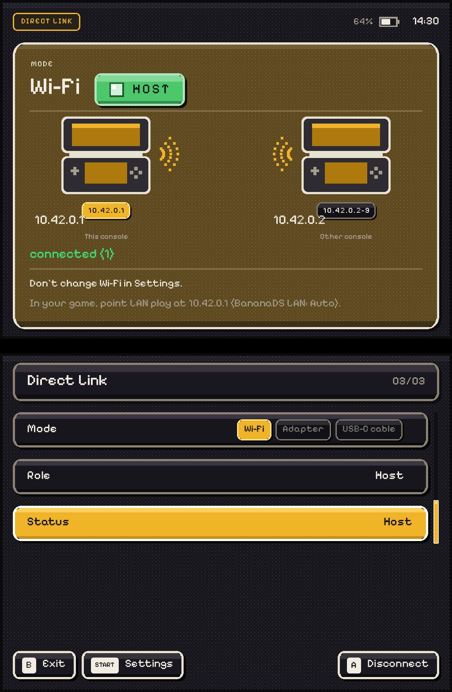
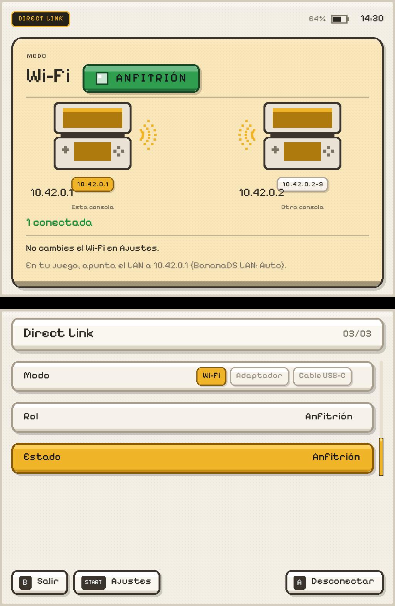

# Direct Link

  <b>A direct Wi-Fi link between two BananaOS handhelds — no router, fixed addresses, games keep talking.</b>

  <a href="#overview">Overview</a> ·
  <a href="#setup">Setup</a> ·
  <a href="#extras">Extras</a>

<table>
  <tr>
    <td align="center" width="50%">
       
      <b>Dark</b> · host on <code>10.42.0.1</code>
    </td>
    <td align="center" width="50%">
       
      <b>Light</b> · Spanish UI
    </td>
  </tr>
</table>

## Overview

- 🔗 **Host or join** — guests use `10.42.0.2`–`10.42.0.9`; the host stays on `10.42.0.1`.
- 🎮 **Stays up** after you leave the app and while you change games.
- 🏠 **Disconnect** brings back your home Wi-Fi (no internet on the link).
- 🔓 **Open link** on stock BananaOS — no link password in the radio stack.
- 🌐 **English or Spanish** — follows the handheld language.

## Setup

1. **Download** the release zip and unzip it.
2. **Easiest:** copy `Install-Direct-Link.sh` into `store/tiles`, reboot, open **Apps**, run the installer tile.
3. **Manual:** put `direct-link` in `store/apps` and `Direct Link.sh` in `store/tiles` (keep the rest of `store` intact). Reboot, then open **Apps**.

When you are done, leave **Apps** and open **Apps** again to refresh the shelf (temporary BananaOS limitation).

Details for the shared **banana** folder are in `INSTALL.txt`.

## Remove it

In the app: **Y**, then **A**. Disconnects and removes the app folder and shelf tile.

## Extras

Optional file `/data/banana/direct-link.conf` (read only): `CHANNEL`, `FREQ`, `SSID`, `BSSID`, `MAX` (seconds; `0` = until you disconnect).

## Built with

Open source (MIT). UI in C; `app/wifi-link` drives the radio. See `build/package.sh` and `build/selftest.sh`.

## Credits

**Pixelado Dev** — AI-assisted development, tested on hardware when possible. Provided as-is; see `LICENSE`.